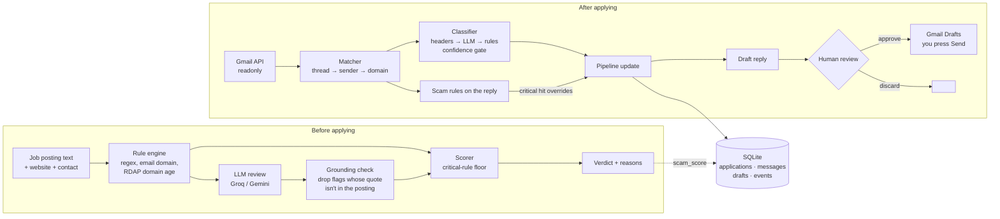

# JobPilot

JobPilot is two agentic add-ons for a job search that uses AutoGrow-style tools. Both run only on legitimate channels, with a human approving every step.

1. **Scam / exploitative posting detector.** Before you apply, it flags fake or predatory postings and gives a plain-English reason for each flag.
2. **Reply & pipeline manager.** After you apply, it reads replies through the Gmail API, classifies each one, updates a pipeline, and drafts a response for you to review. It never sends anything itself.

The recruiting flow has two ends: *finding* the right people and *reaching* them. These add-ons cover the parts on either side of that: what to **avoid**, and what to do **after they reply**.

---

## Architecture



| Layer | Choice | Why |
|---|---|---|
| LLM | Groq (Llama 3.3 70B) or Gemini Flash, free tiers | Both have OpenAI-compatible endpoints, so one client handles either and switching is a single `.env` line |
| Email | Gmail API (`gmail.readonly` + `gmail.compose`) | Official and free. The code never calls `send` |
| Domain age | RDAP via rdap.org | Free, needs no key, and is the modern replacement for WHOIS |
| Storage | SQLite | Zero setup, and you can inspect it live during the demo |
| UI | Streamlit + a `rich` CLI | Fast to build, and the CLI works as a fallback if the UI misbehaves |

## Design decisions worth talking about

- **Rules and the LLM work together.** Rules are cheap, deterministic, never hallucinate, and keep working if the free tier rate-limits you: set `JOBPILOT_RULES_ONLY=1` or leave the key blank. The LLM catches subtler signals like tone, inconsistencies, and copy-paste text.
- **Grounded LLM output.** Every LLM red flag has to quote the posting. Flags whose quote can't be found in the text (by fuzzy match) are dropped, and a test covers this (`test_llm_hallucinated_evidence_is_dropped`).
- **Hard floors.** If a rule finds an upfront fee or an early request for ID or bank details, the risk score can't fall below 60, however lenient the LLM's opinion is.
- **Confidence gating.** A low-confidence classification, or a disagreement between the LLM and the rules, becomes `UNCLEAR` and goes to a human. The agent won't guess about your career.
- **Safety check on replies.** Fake "offers" often arrive as replies. Every inbound email goes through the payment and process scam rules, and a hit overrides the classifier and blocks any draft. The demo's Quanta Retail email shows this.
- **Idempotent and auditable.** Gmail message IDs are unique in the DB, so re-running never double-processes an email. Every action is written to `events`, which the UI shows as an activity log.
- **Human in the loop by construction.** Drafts are created in `PENDING_REVIEW` status. Approving one saves it to *Gmail Drafts*, and you send it yourself.

## Setup (about 10 minutes, no card needed)

```bash
python -m venv .venv && source .venv/bin/activate      # Windows: .venv\Scripts\activate
pip install -r requirements.txt
cp .env.example .env        # paste a Groq or Gemini key (optional; rules-only works without one)
python -m pytest -q         # 14 tests
python demo.py demo         # the whole story in the terminal
streamlit run streamlit_app.py
```

### Connecting your real Gmail

1. In the [Google Cloud Console](https://console.cloud.google.com), create a project and enable the **Gmail API**.
2. On the **OAuth consent screen**, choose External, then add your own Gmail address under **Test users**.
3. Under **Credentials**, create an OAuth client ID of type **Desktop app**, download it, and save it as `credentials.json` in this folder.
4. Run `python demo.py import-sent --query "in:sent newer_than:60d subject:(internship OR application)"`. The first run opens a consent page in your browser. This command seeds the pipeline from applications you've already sent.
5. Run `python demo.py replies --gmail`, or choose **My Gmail** in the UI.

`credentials.json` and `token.json` are git-ignored, so don't commit them.

## 5-minute demo script

| Time | Do | Say |
|---|---|---|
| 0:00 | Sidebar → **Reset demo data** | "Six real-shaped applications, seeded as if I'd sent them from Gmail." |
| 0:20 | **Scam check** → Northwind | "A normal posting: concrete pay, company domain, a real interview process. Nothing flagged." |
| 0:50 | → *URGENT Remote Data Entry* | "Fee, CNIC and bank request, Telegram, crypto pay. Each flag quotes the exact sentence and explains why it matters." |
| 1:40 | → PixelForge | "The subtle one. It isn't a textbook scam, but it wants two weeks of unpaid work on live client sites, over WhatsApp, from a Gmail address. That's exploitative." |
| 2:20 | Toggle the LLM off and on | "The rules alone still catch the dangerous cases. The LLM adds nuance, and its claims must quote the posting or they're dropped." |
| 2:50 | **Process replies** → Sample | "Each reply is matched to its application by thread, then classified with a confidence score. The interview request becomes high priority, the rejection gets closed, and the auto-reply is ignored." |
| 3:40 | Point at Orbital and Quanta | "Orbital is ambiguous, so it goes to me rather than getting a guess. Quanta *looks* like an offer but asks for a fee and my CNIC over WhatsApp. The scam rules override the classifier and block any draft." |
| 4:20 | **Pipeline & drafts** → edit a draft → Approve | "Nothing gets sent. Approving saves it to Gmail Drafts and I press Send. Here's the activity log of every decision." |

## Project layout

```
app/
  llm.py              provider-agnostic JSON chat (Groq/Gemini), retries, rules-only fallback
  scam_detector.py    rules + grounded LLM review + scoring
  domain_check.py     RDAP domain age
  reply_classifier.py header → LLM → rules classifier, confidence gate, reply drafting
  pipeline.py         match → classify → safety-check → update → draft (the agent loop)
  gmail_client.py     OAuth, fetch replies, import sent outreach, create Gmail drafts
  db.py               SQLite schema + queries
data/                 sample postings, outreach, and replies (fictional companies, .example domains)
demo.py               CLI
streamlit_app.py      demo UI
tests/                14 tests, including mocked-LLM tests for grounding and confidence gating
```

## Web version for many users (`web_app.py`)

Anyone on the tester list signs in with Google, picks a period, and watches their own board fill in.

- **Sign in with Google.** OAuth web flow with PKCE and a one-time state. Each user has a private database, and Google tokens are stored encrypted. "Delete my data" removes everything for that user.
- **Period picker.** Today, the last 3 or 7 days, the last 1/3/6/9/12 months, or a custom range of up to one year, with an "include today" option.
- **Real progress.** The app counts every email in the period first (IDs only, which is fast) and subtracts the ones earlier scans finished. It then shows `done / total`. Stop stops after the current batch. Starting again resumes instead of redoing work, and it also survives a server restart.
- **One shared background scanner.** It gives each user one batch in turn (round-robin), so a 7-day scan never waits behind someone's year-long backlog.
- **Frugal with free AI:**
  - rules first (a confident rule hit makes no AI call)
  - a shared, hashed template cache (LinkedIn's "Your update from X" is read by the AI once, for everyone)
  - 6 unclear emails per AI request
  - Groq → Gemini failover (Gemini models are discovered from what your key may use)
  - When every model is at its limit, emails wait for the next scan; nothing is guessed.

Run it with `streamlit run web_app.py`. To host it free for up to 100 testers, see **DEPLOY.md**.

## Roadmap (if AutoGrow wanted it)

- **Posting-level evidence from the web.** Check whether the company has a real careers page and whether the role appears there. That reuses the research-agent layer AutoGrow already has.
- **Eval set.** Add 50 to 100 labeled postings and replies and report precision and recall per label, so prompt changes get measured instead of eyeballed.
- **Follow-up scheduler.** When an application has gone 7 days with no reply, draft a nudge. The same approve-first flow applies.
- **Email channel reuse.** The reply classifier is channel-agnostic, so the same labels work for sales replies (interested / not now / wrong person / unsubscribe) once AutoGrow's email outreach launches.